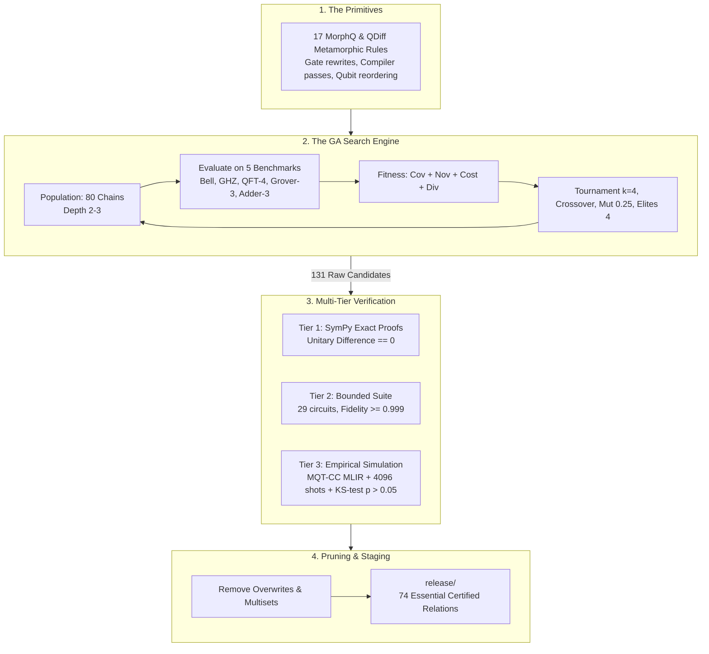
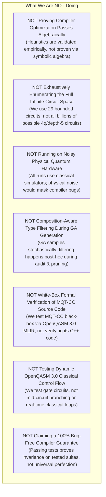

# Core Methodology & Scope: What We Are Doing (And What We Are Not Doing)

> **Document Purpose**:  
> A transparent, comprehensive breakdown of this project's real-world application, technical architecture, and verification methodology, paired with an explicit declaration of **what is outside the current scope**.

---

## 1. Executive Summary

This project automates the quality assurance of modern quantum software compilers. Specifically, it tests the **Munich Quantum Toolkit Compiler Collection (MQT-CC)** when translating quantum programs via OpenQASM 3.0 and MLIR down to quantum simulator targets (`mqt.ddsim.default`).

To solve the **Test Oracle Problem** (the fact that you cannot easily know the exact expected output of a complex quantum circuit), we synthesize and certify **Metamorphic Relations (MRs)** using an evolutionary **Genetic Algorithm (GA)**, verified across mathematical, bounded, and empirical simulation tiers.

---

## 2. PART 1: What We ARE Doing (The Application & Core Details)

### 2.1 The Concrete Application
- **Target Compiler**: Munich Quantum Toolkit Compiler Collection (**MQT-CC**).
- **Interface**: OpenQASM 3.0 programs compiled via MLIR (`mqt.core.mlir.compile_program`) targeting the decision-diagram simulator backend (`mqt.ddsim.default`).
- **Goal**: Detect compiler bugs, transpilation crashes, illegal state modifications, and output probability divergences introduced during optimization.

### 2.2 The 17 Primitive Metamorphic Relations
We draw from two established research foundations:
1. **Mathematical Gate Rewrites (QDiff)**:
   - `QdiffG1SwapToCnot`: $\text{SWAP}(a, b) \leftrightarrow CX(a,b) \cdot CX(b,a) \cdot CX(a,b)$
   - `QdiffG2TwoHToId`: $H \cdot H \leftrightarrow I$
   - `QdiffG3XToHSSH`: $X \leftrightarrow H \cdot S \cdot S \cdot H$
   - `QdiffG4ZtoSS`: $Z \leftrightarrow S \cdot S$
   - `QdiffG5CZtoHCnotH`: $CZ \leftrightarrow (I \otimes H) \cdot CX \cdot (I \otimes H)$
   - `QdiffG6TwoCzToId`: $CZ \cdot CZ \leftrightarrow I$
   - `QdiffG7CCNOTDecomposition`: Decomposes Toffoli into single-qubit and CNOT gates.
2. **Compiler Strategy & Layout Passes (MorphQ)**:
   - `ChangeOptLevel`: Changes compiler pass optimization level ($0, 1, 2, 3$).
   - `ChangeCouplingMap`: Modifies hardware connectivity graphs (coupling density, topology).
   - `ChangeTargetBasis`: Re-expresses circuits using alternative hardware gate sets (e.g., `[rx, ry, rz, cx]` vs `[h, s, t, cx]`).
   - `ChangeBackend`: Changes simulator execution backends.
   - `ChangeQubitOrder`: Scrambles physical wire mappings ($\pi(y)$), requiring output bitstring permutation.
   - `InjectParameters`: Converts concrete gate values into parametric symbols and binds them at runtime.
   - `InjectNullEffect`: Inserts identity gates into idle qubit wires.
   - `AddUnusedRegister`: Adds auxiliary unmeasured classical/quantum registers.
   - `RunIndependentPartitions`: Executes decoupled sub-circuits in parallel.
   - `ToQasmAndBack`: Round-trips the circuit AST to OpenQASM and re-parses.

### 2.3 The Genetic Algorithm (GA) Engine
- **Genes & Chromosomes**: Genes represent parameterized transformations; chromosomes are composite chains of depth $d \in [2, 3]$.
- **Population**: $N = 80$ individuals evolved over $G = 10$ generations.
- **Selection**: Tournament selection ($k = 4$).
- **Crossover**: Single-point crossover with depth clamping to $[2, 3]$.
- **Mutation**: Three-way stochastic mutator ($p_{\text{mut}} = 0.25$):
  - 60% parameter resample
  - 30% primitive replacement
  - 10% adjacent neighbor swap
- **Elitism**: Top 4 individuals ($5\%$) preserved unconditionally.
- **Fitness Function**: Multi-objective balance (25% gate coverage, 25% novelty, 25% cost efficiency, 25% diversity bonus).
- **Deterministic Seeding**: Every chromosome derives a SHA-256 seed from its signature and parameter dictionary, ensuring 100% reproducible evaluations.

### 2.4 The Multi-Tier Verification Process
Every composite chain is evaluated against three certified tiers:
1. **Tier 1 (`PRIMITIVE_SYMBOLIC_CHAIN`)**:
   - For chains consisting solely of discrete gate identities.
   - Uses computer algebra (**SymPy**) to symbolically subtract exact unitary matrices.
   - Confirms that $\Delta = U_1 - U_2 \equiv \mathbf{0}$ (the exact zero matrix).
2. **Tier 2 (`BOUNDED_SUITE_VERIFIED`)**:
   - Evaluates multi-qubit transformations across a bounded combinatorial suite of **29 canonical small circuits** ($\le 4$ qubits, depth $\le 5$).
   - Calculates the exact quantum wave function (**Statevector**) before and after transformation.
   - Asserts state fidelity $F \ge 0.999$.
   - *Zero exception masking*: Any runtime crash or fidelity drop immediately fails the check.
3. **Tier 3 (`EMPIRICALLY_SIMULATED`)**:
   - For compiler heuristics (optimization levels, coupling maps, backends).
   - Compiles through **MQT-CC MLIR** down to DDSIM.
   - Evaluates across **5 standard algorithm benchmarks** (GHZ 3q, Bell 2q, QFT 4q, Grover 3q, Adder 3q).
   - Loops through continuous **boundary angles** ($\{0, \pi/2, \pi, 2\pi, -\pi/2\}$) for parameterized circuits.
   - Remaps measurement bitstrings ($b'_i = b_{\pi(i)}$) for qubit permutations.
   - Runs 4,096 shots on seeded Aer simulation (`seed_simulator=sim_seed`) and asserts two-sample Kolmogorov-Smirnov $p > 0.05$.

### 2.5 Semantic Pruning & Staging
- **State Overwrite Filtering**: Eliminates redundant compiler state overrides (e.g., `ChangeOptLevel -> ChangeOptLevel`).
- **Multiset Deduplication**: Groups commutative pairs (e.g., $A \to B$ vs $B \to A$) and keeps only the highest-fitness representative.
- **Pre-Pruning Filter**: Out of 131 initial GA candidates, 28 were rejected for precondition/KS failures, and 29 redundant duplicates were pruned, leaving **74 essential master relations**.
- **Release Staging**: A dedicated, clean bundle in `release/` containing exactly 74 JSON specifications, 74 OpenQASM 3.0 circuits, and 74 Python execution scripts, with all 57 raw unpruned candidates safely archived in `archive/raw_candidates/`.

---

## 3. PART 2: What We Are NOT Doing (Explicit Boundaries & Non-Goals)

To ensure scientific honesty and prevent misunderstandings, here is what our current implementation **deliberately does not do**:

### 3.1 We Are NOT Algebraically Proving Compiler Passes
- **What is proven**: Pure gate substitutions ($X \leftrightarrow HSSH$, $\text{SWAP} \leftrightarrow 3 \times CX$) are proven exact via SymPy unitary matrix algebra.
- **What is NOT proven**: Transformations like `ChangeOptLevel`, `ChangeCouplingMap`, and `ChangeBackend` are **not** algebraically proven. Compiler heuristics (like Sabre routing, graph coloring layout, and peephole optimization) cannot be proven by simple matrix subtraction. They are validated **empirically and statistically**, not mathematically proven for all possible inputs.

### 3.2 We Are NOT Exhaustively Enumerating All Possible Circuits
- **What we do**: We test against a bounded combinatorial test suite of **29 handcrafted canonical circuits** ($\le 4$ qubits, depth $\le 5$).
- **What we do NOT do**: We do **not** simulate every mathematically possible quantum circuit in that domain. With 9 gate types and 4 qubits, the full combinatorial space of all depth-5 circuits exceeds $36^5 \approx 60\text{ million}$ circuits. We do not claim exhaustive domain coverage.

### 3.3 We Are NOT Executing on Physical Quantum Hardware
- **What we do**: All executions run on classical quantum simulators: **MQT DDSIM** (Decision Diagram Simulator) and **Qiskit Aer** (`aer_simulator`).
- **What we do NOT do**: We do **not** execute on real physical quantum processing units (QPUs) like IBM Falcon or Rigetti Aspen.
- **Why?** Real physical QPUs suffer from physical decoherence, gate infidelities ($0.1\% - 1\%$), and measurement readout noise. Real physical noise creates statistical fluctuations that would mask subtle compiler bugs. Testing a compiler requires an idealized, noiseless simulation baseline.

### 3.4 We Are NOT Enforcing Composition Contracts During GA Generation
- **What we do**: The GA generates chains stochastically and filters out broken or redundant chains during evaluation and post-hoc pruning.
- **What we do NOT do**: The GA does **not** yet use an *a priori* type system during crossover and mutation. It does not prevent an individual from being created with `ChangeOptLevel -> ChangeOptLevel`; it simply identifies and eliminates that individual during the post-synthesis pruning pass.

### 3.5 We Are NOT Doing White-Box Formal Verification of MQT-CC Source Code
- **What we do**: Black-box / gray-box metamorphic testing. We feed OpenQASM 3.0 programs into MQT-CC's MLIR compiler pipeline (`mqt.core.mlir.compile_program`), execute the output, and compare measurement distributions.
- **What we do NOT do**: We do **not** perform static analysis, formal theorem proving (like Coq or Lean), or symbolic execution on MQT-CC's internal C++ source code.

### 3.6 We Are NOT Testing Dynamic Classical Control Flow in OpenQASM 3.0
- **What we do**: We test standard quantum circuits containing quantum registers, standard gates, continuous parameter bindings, and final measurements.
- **What we do NOT do**: OpenQASM 3.0 supports complex classical control flow (e.g. `while` loops, mid-circuit measurement with dynamic feed-forward resets, classical arithmetic variables). We do **not** generate or test dynamic mid-circuit classical branching.

### 3.7 We Are NOT Claiming a 100% Bug-Free Compiler Guarantee
- **What we do**: We certify that our 74 essential metamorphic relations achieved a **100.0% pass rate** across our 5 algorithm benchmarks and 29 bounded circuits.
- **What we do NOT do**: We do **not** claim that MQT-CC has zero bugs. Metamorphic testing can prove the *presence* of bugs (when a test fails); passing all tests proves that the compiler preserves semantics across the tested benchmark suite, but no testing methodology can mathematically prove the total absence of bugs in a compiler.

---

## 4. Summary Matrix: "What We Do" vs "What We Don't"

| Dimension | What We ARE Doing | What We Are NOT Doing |
| :--- | :--- | :--- |
| **Compiler Target** | Black-box testing of MQT-CC via OpenQASM 3.0 MLIR | Formal verification of MQT-CC C++ source code |
| **Mathematical Proofs** | SymPy exact zero-matrix subtraction for primitive gate identities | Mathematical proofs for heuristic compiler passes (opt levels, coupling maps) |
| **Circuit Domain** | 5 algorithm benchmarks + 29-circuit bounded test suite | Exhaustive evaluation of all 60M+ combinatorial circuits |
| **Execution Environment**| Noiseless classical simulators (DDSIM, Aer) | Physical noisy quantum hardware |
| **GA Synthesis** | Stochastic evolution with post-hoc semantic pruning | *A priori* type-directed grammar constraints during crossover |
| **Quantum Language** | Pure quantum circuits with parameter bindings and measurement | Dynamic mid-circuit classical control loops (`while`, branching) |
| **Quality Claim** | 100% pass rate across the tested benchmark and bounded suites | Claiming the compiler is universally 100% bug-free |

---

## 5. Why This Scope Is Scientifically Sound

By explicitly defining these boundaries, our methodology adheres to established principles of software engineering research:
1. **Separation of Concerns**: Algebraic proofs are claimed only where exact matrix math holds; statistical simulation is used where compiler heuristics dictate empirical validation.
2. **Deterministic Reproducibility**: Using simulated baselines and cryptographic seeds guarantees that every test result can be independently audited and replicated without hardware drift.
3. **Actionable Test Suite**: The resulting **74 essential relations staged in `release/`** provide an optimized, non-redundant, ready-to-deploy test suite specifically tailored for MQT-CC compiler validation.
