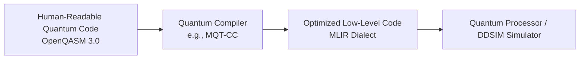
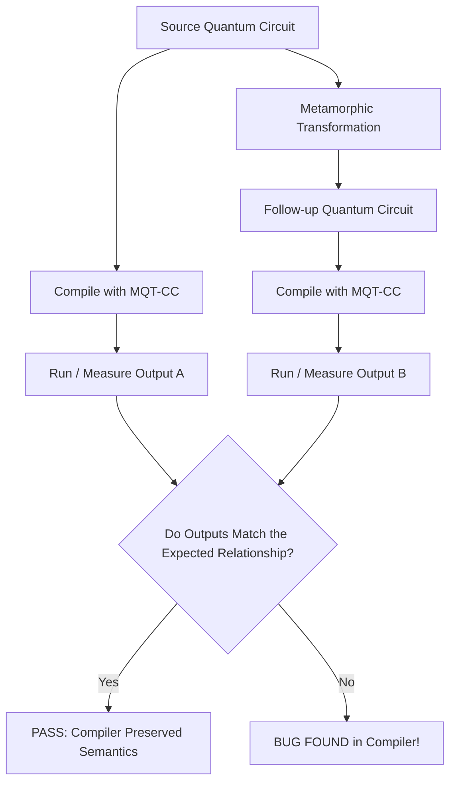
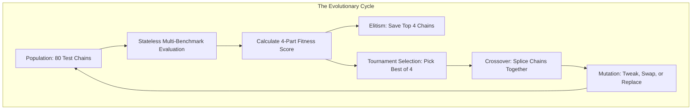
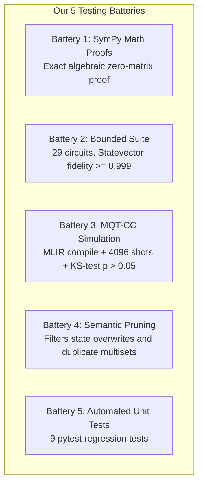

# Understanding Quantum Compiler Testing: A Plain-English Guide

> **Who is this guide for?**  
> Anyone curious about what this project does—written to be crystal clear even if you have no prior background in quantum computing, advanced mathematics, or compiler internals!

---

## 1. The Big Picture: What Are We Doing Here?

Computers run on software. Before computer code can run on a physical computer chip, a specialized program called a **compiler** translates human-readable code into low-level machine instructions.

Just like conventional computers, **quantum computers** need compilers. A quantum compiler takes a quantum algorithm (written as a "quantum circuit") and translates, optimizes, and rewrites it so physical quantum hardware or simulators can execute it.

**The big problem:** Quantum compilers are extremely complex. If the compiler contains a subtle bug, it might silently alter what the quantum program is supposed to compute!

**Our mission:** Build an automated testing pipeline that invents clever, bulletproof tests to catch bugs inside modern quantum compilers—specifically targeting **MQT-CC** (the Munich Quantum Toolkit Compiler Collection).

---

## 2. Why Is Testing Quantum Compilers So Difficult? (The "Oracle Problem")

In ordinary software testing, checking if a program works is straightforward:
- If you test a calculator app with `2 + 2`, you check if the answer is `4`.
- The expected answer (`4`) is called the **test oracle**.

In quantum computing, this breaks down for two fundamental reasons:

1. **Exponential Complexity**: Simulating a quantum circuit with just 50 or 60 qubits on a conventional computer would require more RAM than all the computers on Earth combined. You cannot easily compute the "expected answer" in advance to compare against!
2. **Quantum Randomness**: Quantum computers do not output a single clean number; they output probabilities. When you measure a quantum computer, it rolls quantum dice and gives you a bitstring (e.g., `1010`). To know if the program worked, you have to run it thousands of times and verify the statistical distribution.

If you don't know the exact answer to a complex quantum program, **how can you test whether the compiler translated it correctly?**

---

## 3. The Secret Weapon: Metamorphic Testing

Imagine you want to test an airport luggage scale, but you don't have a certified 50.00 lb test weight. How can you tell if the scale is broken?

1. You weigh your suitcase. The scale says: **42 lbs**. (You don't know if this is true).
2. You take a 1-pound book out of your bag and place it next to the suitcase on the scale.
3. The scale *must* now read **43 lbs**.

You didn't need to know the true weight of the suitcase! You only needed to know the **relationship** between the first test and the second test.

This technique is called **Metamorphic Testing**:
- You take an original program (**Source**).
- You make a deliberate, well-understood modification to create a new program (**Follow-up**).
- You compile and run both, and verify that the relationship between their outputs matches what mathematics predicts.

---

## 4. The Building Blocks: 17 Primitive Rules

Researchers previously developed isolated rules for quantum testing (from frameworks called **MorphQ** and **QDiff**). Think of these as our 17 "Lego bricks":

### Category A: Mathematical Gate Identities (QDiff)
These are pure mathematical substitutions. If you replace a gate with an identical sequence, the quantum state shouldn't change at all:
- **Rule 1 (SWAP to CNOT)**: Swapping two quantum wires is mathematically identical to 3 back-to-back Controlled-NOT gates ($CX-CX-CX$).
- **Rule 2 (Hadamard Identity)**: Applying two Hadamard ($H$) gates in a row cancels out to do nothing ($H \cdot H = I$).
- **Rule 3 (Pauli-X Identity)**: A bit-flip gate ($X$) is identical to $H \cdot S \cdot S \cdot H$.
- **Rule 4 (Pauli-Z Identity)**: A phase-flip gate ($Z$) is identical to two quarter-phase gates ($S \cdot S$).
- **Rule 5 (Controlled-Z)**: A $CZ$ gate is identical to an $H$ gate, followed by a CNOT, followed by an $H$ gate.
- **Rule 6 (Two CZs)**: Two $CZ$ gates in a row cancel out.

### Category B: Compiler Strategy Adjustments (MorphQ)
These change how the compiler behaves rather than altering the quantum physics:
- **Optimization Levels**: Tells the compiler to optimize lightly (Level 0) or aggressively (Level 3). The physical output must remain unchanged.
- **Qubit Permutation**: Shuffling the input wire labels. If we swap wire 0 and wire 1, the output bitstrings must simply have bits 0 and 1 swapped.
- **Target Gate Sets**: Forcing the compiler to express the circuit using different physical hardware instructions (e.g., using `[rx, ry, rz, cx]` instead of `[h, s, t, cx]`).
- **Coupling Maps**: Changing the physical hardware layout graph (which qubits can physically connect to which other qubits).

---

## 5. Our Approach: The Genetic Algorithm (GA) Explained

Single, isolated rules rarely catch subtle compiler bugs. Modern compilers are already tested against basic single-step rules.

**Real bugs hide in complex, multi-step interactions:**
> *"What happens if the compiler first scrambles qubit order, then decomposes a Controlled-Z gate, and then applies aggressive Level 3 pass optimization on a constrained coupling map?"*

Humans are bad at inventing hundreds of multi-step combinations. So we use a **Genetic Algorithm (GA)**—software that mimics biological evolution to discover powerful testing chains!

### 5.1 How the GA Represents Tests (Genes & Chromosomes)
- **Gene**: A single transformation rule with its settings.  
  *Example*: `ChangeOptLevel(levels=[0, 2, 3])` or `QdiffG1SwapToCnot()`.
- **Chromosome**: A sequence of genes chained together.  
  *Example*: `SwapToCNOT -> ChangeCouplingMap -> ChangeOptLevel`.
- **Chain Depth**: We strictly enforce that chains must have **2 or 3 steps**. Chains with only 1 step are too simple, while chains with 4 or more steps create redundant compiler overwrites.

### 5.2 Selection: Tournament Selection ($k=4$)
To pick parent chains for breeding, the algorithm uses a sports-style tournament:
- It randomly grabs 4 chains from the population.
- The chain with the highest fitness score wins and gets to reproduce.
- This creates strong pressure toward high-performing tests without letting a single "super-test" take over the entire population.

### 5.3 Crossover: Splicing Chains Together
Like combining DNA from two parents:
- Parent 1: `Rule A -> Rule B`
- Parent 2: `Rule X -> Rule Y`
- The algorithm cuts them and splices them to create new children: `Rule A -> Rule Y` and `Rule X -> Rule B`.
- If a child becomes too long or too short, it is automatically clamped back into the 2-to-3 step window.

### 5.4 Mutation: Random Tweaks (25% Chance)
Every gene in a child chain has a $25\%$ chance of mutating:
1. **Parameter Tweak (60% of mutations)**: Keeps the same rule, but picks different settings (e.g., changes optimization level from 2 to 3, or adjusts connection density).
2. **Component Swap (30% of mutations)**: Replaces the rule entirely with one of the other 17 primitives.
3. **Neighbor Swap (10% of mutations)**: Swaps the order of two adjacent steps to test order sensitivity.

### 5.5 Elitism: Preserving the "Hall of Fame" ($E=4$)
In every generation, the top 4 fittest chains are automatically copied into the next generation unchanged. This guarantees that the algorithm never loses its best discoveries.

### 5.6 The Multi-Objective Fitness Formula
How does the algorithm decide which test chains are "fittest"? It evaluates each chain against 5 benchmark quantum algorithms and scores it on 4 balanced objectives:

$$\text{Fitness} = 0.25 \cdot \text{Coverage} + 0.25 \cdot \text{Novelty} + 0.25 \cdot \text{Cost} + 0.25 \cdot \text{Diversity}$$

1. **Gate Coverage ($25\%$)**: Rewards chains that exercise many different types of quantum gates ($H, X, Z, S, T, CX, CZ, \text{SWAP}, CCX$).
2. **Novelty ($25\%$)**: Rewards chains that explore new, creative combinations that haven't been tried in previous generations.
3. **Cost Efficiency ($25\%$)**: Rewards concise circuits, penalizing chains that bloat the circuit with thousands of unnecessary gates.
4. **Diversity Bonus ($25\%$)**: Gives extra points to chains that use rarely-used rules, preventing the algorithm from spamming the easiest transformations over and over.

### 5.7 Deterministic Seeding (100% Reproducibility)
In early versions, random transformations could produce different outputs each time they were run. In our hardened system, every chromosome generates its own unique digital fingerprint using **SHA-256 cryptographic hashing**. This seed is passed directly to the random number generators and quantum simulators, ensuring that running the test today, tomorrow, or next year produces the exact same result!

---

## 6. Hyperparameters: The "Dials and Knobs" of the GA

Hyperparameters are the configuration settings that control how the algorithm searches. Here is every dial we set, and the plain-English reason why:

| Dial (Hyperparameter) | Setting | Why This Value Was Chosen |
| :--- | :---: | :--- |
| **Population Size ($N$)** | `80` | Big enough to test many combinations at once, but small enough to run quickly without melting your CPU. |
| **Generations ($G$)** | `10` | 10 rounds $\times$ 80 individuals = up to 800 test chains explored. Most optimal rules are found by round 7 or 8. |
| **Tournament Size ($k$)** | `4` | 5% of the population. Striking the sweet spot: weak enough to keep diversity alive, strong enough to weed out bad tests. |
| **Elitism Count ($E$)** | `4` | Protects the top 5% "all-star" tests from being accidentally mutated away. |
| **Mutation Rate ($p_{\text{mut}}$)** | `0.25` | A 25% chance per gene ensures an average of $\sim 0.6$ tweaks per chain—enough to explore new ideas without wrecking working tests. |
| **Chain Depth Range** | `[2, 3]` | 1 step is too simple to catch compiler bugs; $\ge 4$ steps create redundant overwrites. 2 to 3 steps is the "Goldilocks zone." |
| **Stagnation Patience** | `8` | If the best score hasn't improved in 8 rounds, the algorithm knows it has found the peak and stops early to save time. |
| **Simulation Shots** | `4,096` | Running each circuit 4,096 times gives high statistical confidence for probability distributions. |
| **KS Significance ($\alpha$)** | `p > 0.05` | Standard scientific standard. If the probability score drops to $\le 0.05$, there is a 95% chance the compiler introduced an error! |
| **Master Random Seed** | `42` | Locks down all randomness so the entire experiment is 100% reproducible. |

---

## 7. The Different Tests We Are Doing (The Verification Ladder)

Once the Genetic Algorithm evolves a composite testing rule, **how do we know the rule itself isn't broken?** We subject every rule to five distinct testing batteries:

### Battery 1: Pure Mathematical Proofs (`PRIMITIVE_SYMBOLIC_CHAIN`)
- **What it does**: Proves mathematical gate substitutions using computer algebra (**SymPy**).
- **How it works**: Instead of running approximations, it writes out the exact mathematical matrices using $\sqrt{2}$ and imaginary numbers $i$. It subtracts the two matrices ($U_{\text{original}} - U_{\text{transformed}}$) and verifies that every single entry simplifies to exactly **zero**.
- **Scope**: Applied to discrete gate identities (e.g., SWAP = 3 CNOTs, Hadamard canceling itself, etc.).

### Battery 2: Bounded Combinatorial Test Suite (`BOUNDED_SUITE_VERIFIED`)
- **What it does**: Validates multi-qubit rules on small quantum circuits before trusting them on large algorithms.
- **The Suite**: A curated collection of **29 canonical circuits** spanning 1 to 4 qubits and depth up to 5 (covering single gates, entangling pairs, Toffoli gates, and swap networks).
- **How it works**: Computes the exact quantum wave function (**Statevector**) before and after transformation and calculates quantum **fidelity**:
  $$\text{Fidelity} = |\langle \psi_{\text{orig}} | \psi_{\text{trans}} \rangle|^2 \ge 0.999$$
- **Zero Exception Masking**: If a circuit crashes, encounters an error, or fidelity drops below $99.9\%$, it fails immediately.

### Battery 3: Empirical Statistical Simulation with MQT-CC (`EMPIRICALLY_SIMULATED`)
- **What it does**: Tests real-world compiler settings (optimization passes, hardware layouts, backend targets) that cannot be proved by pure matrix math.
- **Target Compiler**: Compiles the circuits through **MQT-CC** via OpenQASM 3.0 MLIR down to the DDSIM simulator.
- **5 Algorithm Benchmarks**:
  1. `bell_state` (2 qubits): Basic quantum entanglement.
  2. `ghz_state` (3 qubits): 3-party entanglement with gate cancellations.
  3. `qft_4qubit` (4 qubits): Quantum Fourier Transform with fractional rotation angles.
  4. `grover_3qubit` (3 qubits): Grover's quantum search algorithm.
  5. `adder_3qubit` (3 qubits): Quantum arithmetic addition.
- **Boundary Angle Testing**: For rotation gates, tests boundary angles: $\{0, \pi/2, \pi, 2\pi, -\pi/2\}$.
- **Permutation Remapping**: If a rule scrambles qubit wire order, it remaps the output bitstrings so classical registers align.
- **Kolmogorov-Smirnov (KS) Test**: Simulates 4,096 measurement shots and asserts that the two-sample KS-test p-value satisfies $p > 0.05$.

### Battery 4: Semantic Deduplication & Pruning
- **State Overwrite Elimination**: Discards nonsensical chains where a compiler pass is immediately overwritten (e.g., setting Optimization Level 2 and then immediately setting it back to Level 0).
- **Commutative Multiset Grouping**: If Chain A is `Rule1 -> Rule2` and Chain B is `Rule2 -> Rule1`, they test the exact same combination. We group them and keep only the single highest-fitness representative.
- **The Filter**: Out of 131 initial GA candidates, 28 were rejected for failures, and 29 redundant duplicates were pruned, leaving **74 essential master rules**.

### Battery 5: Automated Unit Test Battery (`tests/`)
We maintain 9 automated unit tests running in `pytest` to guarantee the codebase never breaks:
1. `test_audit_determinism.py`: Proves that running the audit twice produces byte-for-byte identical results.
2. `test_determinism.py`: Proves chromosome evaluation is stateless and order-independent.
3. `test_operators.py` (3 tests): Validates parameter invariants (e.g. minimum connection density $\le$ maximum), crossover depth clamping, and mutation logic.
4. `test_proofs.py`: Verifies all 6 SymPy matrix differences equal exact zero matrices.
5. `test_pruning.py` (2 tests): Tests overwrite detection and commutative multiset grouping.
6. `test_schema.py`: Validates all 17 primitive MR definitions against `schema.json`.

---

## 8. Final Results Summary

Across our final release library of **74 certified essential metamorphic relations**:

| Verification Tier | Certified Count | Share | How It Was Verified |
| :--- | :---: | :---: | :--- |
| **`PRIMITIVE_SYMBOLIC_CHAIN`** | **9** | **12.2%** | Mathematically proven identically zero in SymPy ($U_1 - U_2 \equiv 0$). |
| **`BOUNDED_SUITE_VERIFIED`** | **30** | **40.5%** | Statevector fidelity $\ge 0.999$ across 29 canonical circuits ($\le 4$q, depth $\le 5$). |
| **`EMPIRICALLY_SIMULATED`** | **35** | **47.3%** | MQT-CC MLIR compilation + KS-test ($p > 0.05$) across 5 standard quantum algorithms. |
| **FAILED** | **0** | **0.0%** | **100.0% Pass Rate across the release library (74/74)** |

---

## 9. Plain-English Glossary

| Term | Plain-English Definition |
| :--- | :--- |
| **Quantum Circuit** | A step-by-step recipe of quantum operations (gates) performed on quantum bits (qubits). |
| **Qubit** | The basic unit of quantum information. Unlike a classical bit (which is 0 or 1), a qubit can exist in a superposition of both. |
| **Quantum Gate** | An operation that alters the state of one or more qubits (e.g., $X$ flips 0 to 1, $H$ creates superposition). |
| **Compiler** | A software translation program that takes high-level circuit instructions and rewrites them so physical hardware can run them. |
| **MQT-CC** | Munich Quantum Toolkit Compiler Collection. A state-of-the-art quantum compiler targeting OpenQASM 3.0 via MLIR. |
| **OpenQASM 3.0** | The standard programming language used to describe quantum circuits and classical control logic. |
| **Metamorphic Relation (MR)** | A known relationship between the input and output of a program that allows you to test the software without knowing the exact answer in advance. |
| **Genetic Algorithm (GA)** | An optimization technique inspired by natural selection that evolves sequences of rules over generations. |
| **Gene / Chromosome** | In our GA, a gene is a single testing rule, and a chromosome is a 2-to-3 step chain of rules. |
| **Tournament Selection** | Randomly picking $k=4$ test chains and picking the highest-scoring one to reproduce. |
| **Crossover / Mutation** | Splicing two test chains together (crossover) or randomly tweaking settings and gates (mutation). |
| **Elitism** | Saving the top 4 best-performing test chains so they are never lost across generations. |
| **Statevector** | The full, exact mathematical description of a quantum computer's wave function (only computable for small circuits on classical computers). |
| **Fidelity** | A mathematical score between 0.0 and 1.0 measuring how close two quantum states are. A score of 1.0 means identical. |
| **Kolmogorov-Smirnov (KS) Test** | A statistical test that compares two sets of measurement numbers to determine whether they were drawn from the same underlying probability distribution. |
| **Shots** | The number of times a quantum circuit is executed on a simulator or device to collect statistical measurement frequencies. |
