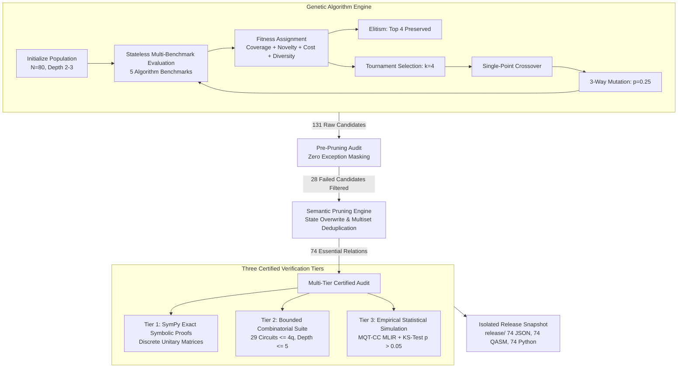

# Comprehensive Technical Guide: GA Architecture, Hyperparameters, and Verification Testing

This document details the engineering architecture, genetic algorithm mechanics, hyperparameter design decisions, and multi-tier testing batteries implemented in this project to test the **Munich Quantum Toolkit Compiler Collection (MQT-CC)**.

---

## 1. System Architecture Overview

The testing framework automatically synthesizes, evaluates, prunes, and certifies **Metamorphic Relations (MRs)** for quantum compilers.

---

## 2. Genetic Algorithm (GA) Deep Dive

### 2.1 Chromosome & Gene Representation
- **Gene**: Represents a single metamorphic transformation primitive $M_i$ parameterized by a parameter dictionary $\theta_i$:
  $$g = \langle \text{mr\_id}, \theta \rangle$$
  *Examples:*
  - `QdiffG1SwapToCnot` with $\theta = \{\}$
  - `ChangeOptLevel` with $\theta = \{\text{"levels"}: [0, 2, 3]\}$
  - `ChangeCouplingMap` with $\theta = \{\text{"min\_density"}: 0.10, \text{"max\_density"}: 0.25, \dots\}$
- **Chromosome**: An ordered sequence of genes representing a composite transformation chain:
  $$C = [g_1, g_2, \dots, g_d]$$
  where $d \in [2, 3]$ is the chain depth.
- **Structural Signature**: A canonical string identifier describing the composite rule:
  $$\text{Sig}(C) = g_1.\text{id}(\text{keys}(\theta_1)) \to g_2.\text{id}(\text{keys}(\theta_2)) \to \dots$$

### 2.2 Selection Operator: Tournament Selection ($k=4$)
To select parent chromosomes for reproduction, we sample $k=4$ individuals uniformly at random from the population and select the individual with the highest fitness:
$$P_1 = \arg\max_{c \in \text{Sample}(4)} \text{Fitness}(c)$$
- **Why $k=4$?** Standard roulette-wheel selection suffers from premature convergence if one super-individual dominates. A tournament size of 4 provides strong selection pressure toward high-performing relations while maintaining enough genetic diversity to prevent the population from getting trapped in local optima.

### 2.3 Crossover Operator: Single-Point with Depth Clamping
Given two parents $P_1 = [g_1^{(1)}, \dots, g_{d_1}^{(1)}]$ and $P_2 = [g_1^{(2)}, \dots, g_{d_2}^{(2)}]$:
1. Random split points $p_1 \in [1, d_1 - 1]$ and $p_2 \in [1, d_2 - 1]$ are chosen.
2. Offspring chains are formed by splicing heads and tails:
   $$C_1 = P_1[:p_1] + P_2[p_2:], \quad C_2 = P_2[:p_2] + P_1[p_1:]$$
3. **Depth Clamping**: If $\text{len}(C) > 3$, it is truncated to 3; if $\text{len}(C) < 2$, a randomly sampled valid gene is appended. This enforces the strict invariant $d \in [2, 3]$.

### 2.4 Mutation Operator: Three-Way Stochastic Mutator ($p_{\text{mut}} = 0.25$)
Each gene in an offspring chromosome has a $25\%$ probability of mutation. When a gene mutates, one of three mutually exclusive actions occurs:
1. **Parameter Tweak (60% probability)**: Keeps the same transformation primitive but resamples its hyperparameter dictionary $\theta$ (e.g., choosing a different optimization level or coupling density).
2. **Component Replacement (30% probability)**: Replaces the entire transformation with a completely different primitive chosen from the 17 available MRs.
3. **Neighbor Swap (10% probability)**: Swaps the position of two adjacent genes in the chain to test order sensitivity.

### 2.5 Multi-Objective Fitness Formulation
Evaluating a candidate chromosome $C$ produces four normalized objective scores:
$$\text{Fitness}(C) = w_{\text{cov}} \cdot \text{Cov}(C) + w_{\text{nov}} \cdot \text{Nov}(C) + w_{\text{cost}} \cdot \text{Cost}(C) + w_{\text{bonus}} \cdot \text{Div}(C)$$
All weights are balanced equally:
$$w_{\text{cov}} = w_{\text{nov}} = w_{\text{cost}} = w_{\text{bonus}} = 0.25$$

| Objective Term | Mathematical Definition | Purpose & Optimization Goal |
| :--- | :--- | :--- |
| **Coverage** $\text{Cov}(C)$ | $\min\left(1.0, \frac{|G_{\text{unique}}|}{8}\right)$ | Rewards chains that exercise diverse quantum gates ($H, X, Z, S, T, CX, CZ, \text{SWAP}, CCX$). |
| **Cost Efficiency** $\text{Cost}(C)$ | $\frac{1}{1 + 0.04 \cdot N_{\text{ops}}}$ | Penalizes unnecessarily bloated circuits to keep compilation and simulation fast. |
| **Novelty** $\text{Nov}(C)$ | $1.0 - \max_{P \in \text{Archive}} \text{Jaccard}(C_{\text{MRs}}, P_{\text{MRs}})$ | Rewards chains that explore new combinations compared to previous generations. |
| **Diversity Bonus** $\text{Div}(C)$ | $\frac{1}{d} \sum_{i=1}^d \frac{1}{1 + \text{Count}(g_i.\text{id})}$ | Penalizes frequently overused primitives, boosting rare transformations. |

### 2.6 Order-Independent Evaluation Architecture
In previous versions, fitness was calculated dynamically while updating the archive, making evaluation order-dependent. In the hardened system:
1. Individuals are evaluated **statelessly** against the 5 benchmarks.
2. Novelty and diversity are calculated at **generation boundaries** against a frozen snapshot of the previous generation archive.
3. Random transformations receive a deterministic seed derived from the chromosome's SHA-256 hash:
   $$\text{Seed}(C) = \text{SHA-256}(\text{Sig}(C) \,\|\, \theta)[:8]$$
This guarantees that evaluating chromosome $C$ will yield the exact same fitness score at any time, in any order.

---

## 3. Hyperparameter Rationale & Configuration

| Hyperparameter | Value | Technical Justification |
| :--- | :---: | :--- |
| **Population Size ($N$)** | `80` | Provides sufficient genetic diversity to cover the combinatorial space of 17 primitives without slowing down multi-benchmark execution. |
| **Max Generations ($G$)** | `10` | Together with $N=80$, allows evaluating up to 800 individuals. Empirical convergence occurs around Generation 7–8. |
| **Tournament Size ($k$)** | `4` | $5\%$ of population size. Prevents early super-individual domination while ensuring healthy selective pressure. |
| **Elitism Count ($E$)** | `4` | Preserves the top $5\%$ fittest chromosomes unchanged across generations, guaranteeing monotonicity of best fitness. |
| **Mutation Rate ($p_{\text{mut}}$)** | `0.25` | A $25\%$ chance per gene ensures an average of $\sim 0.6$ mutations per chromosome, balancing exploration and stability. |
| **Chain Depth Range** | `[2, 3]` | Length 1 is just primitive testing; lengths $> 3$ produce redundant state overwrites. Lengths 2–3 capture multi-pass interactions while remaining debuggable. |
| **Stagnation Patience** | `8` | Triggers early stopping if the population's best fitness does not improve by at least $10^{-4}$ for 8 consecutive generations. |
| **Simulation Shots** | `4096` | High statistical confidence for two-sample KS-tests while keeping Aer simulator runtime under 10 ms per circuit. |
| **KS Alpha Threshold** | `p > 0.05` | Standard statistical threshold ($\alpha = 0.05$). Any p-value $\le 0.05$ rejects the hypothesis of identical distributions. |
| **Random Seed** | `42` | Global master seed ensuring 100% bit-level reproducibility of the GA execution. |

---

## 4. The Four Testing & Verification Batteries

### Battery 1: SymPy Exact Symbolic Proofs (Tier 1)
- **Tool**: `sympy.matrices.Matrix` and symbolic algebra.
- **Scope**: Applied exclusively to discrete unitary gate rewrite chains where every constituent gene is a pure mathematical identity.
- **Proof Method**:
  For each gate identity, the exact unitary matrices are defined symbolically (using $\sqrt{2}$ and imaginary unit $I$ without floating-point approximations):
  $$\Delta = U_{\text{target}} - U_{\text{composed}}$$
  The engine simplifies every entry: $\Delta_{i,j} = \text{simplify}(\Delta_{i,j})$.
  It asserts that $\Delta \equiv \mathbf{0}$ (the exact zero matrix).
- **Proved Rules**:
  1. $\text{SWAP} = CX(0,1) \cdot CX(1,0) \cdot CX(0,1)$
  2. $H \cdot H = I_2$
  3. $X = H \cdot S \cdot S \cdot H$
  4. $Z = S \cdot S$
  5. $CZ = (I \otimes H) \cdot CX \cdot (I \otimes H)$
  6. $CZ \cdot CZ = I_4$

### Battery 2: Bounded Combinatorial Test Suite (Tier 2)
- **Tool**: Qiskit `Statevector` and `state_fidelity`.
- **Scope**: Evaluates multi-qubit transformations across a curated battery of **29 canonical circuits** spanning 1 to 4 qubits and depth up to 5:
  - 1-qubit gate pair combinations ($H, X, Z, S, T$).
  - 2-qubit entangling sequences ($CX, CZ, \text{SWAP}$).
  - 3-qubit Toffoli cascades and multi-qubit rotations.
  - 4-qubit linear entangling chains and swap networks.
- **Verification Criterion**:
  For every circuit where the relation's precondition is satisfied, calculate:
  $$F(\psi_{\text{orig}}, \psi_{\text{trans}}) = |\langle \psi_{\text{orig}} | \psi_{\text{trans}} \rangle|^2$$
  The relation passes if and only if:
  $$\text{Tested} > 0 \quad \text{and} \quad \text{Passed} == \text{Tested} \quad \text{and} \quad \min(F) \ge 0.999$$
  *Zero exception masking*: Any dimension mismatch, syntax crash, or fidelity drop immediately fails the check.

### Battery 3: Empirical Statistical Simulation with MQT-CC (Tier 3)
- **Target Compiler**: Munich Quantum Toolkit Compiler Collection (**MQT-CC**) via OpenQASM 3.0 MLIR frontend (`mqt.core.mlir.compile_program` targeting `mqt.ddsim.default`).
- **Benchmark Battery**:
  1. `bell_state`: 2-qubit Bell pair ($\frac{|00\rangle + |11\rangle}{\sqrt{2}}$).
  2. `ghz_state`: 3-qubit GHZ entangling circuit with cancellation and swap passes.
  3. `qft_4qubit`: 4-qubit Quantum Fourier Transform with fractional phase gates.
  4. `grover_3qubit`: 3-qubit Grover Search algorithm with oracle and diffusion inversion.
  5. `adder_3qubit`: 3-qubit quantum full adder utilizing Toffoli and CNOT logic.
- **Continuous Parameter Sweeps**:
  For parameterized circuits (like `PhaseGate(\theta)` in QFT), the engine systematically loops over boundary rotation angles:
  $$\theta \in \left\{ 0.0, \, \frac{\pi}{2}, \, \pi, \, 2\pi, \, -\frac{\pi}{2} \right\}$$
  verifying that MQT-CC compiles and runs across all boundary angles.
- **Permutation-Aware Statistical Oracle**:
  When `ChangeQubitOrder` permutes qubits with mapping $\pi: \{0 \dots n-1\} \to \{0 \dots n-1\}$, the measurement bitstrings from the transformed circuit are remapped before comparison:
  $$b'_i = b_{\pi(i)}$$
- **Kolmogorov-Smirnov Test**:
  Simulates both original and transformed circuits with 4,096 shots using seeded Aer simulation (`seed_simulator=sim_seed`). Compares the resulting sample distributions via two-sample KS-test:
  $$\text{Assert } p\text{-value} > 0.05$$

### Battery 4: Semantic Deduplication & Pruning
- **State Overwrite Detection**: Identifies and discards chains containing redundant compiler-state overrides (e.g., `ChangeOptLevel -> ... -> ChangeOptLevel`).
- **Commutative Multiset Grouping**: Identifies chains that have identical constituent MRs regardless of ordering (e.g., $M_A \to M_B$ vs $M_B \to M_A$), selecting only the single highest-fitness representative.
- **Pre-Pruning Audit Filter**: Automatically checks `all_candidates_audit_manifest.json` and excludes any relation that failed verification.

---

## 5. Automated Unit Test Battery (`tests/`)

We maintain 9 automated unit tests running in pytest to guarantee regression-free execution:

| Test File | Verified Property |
| :--- | :--- |
| `tests/test_audit_determinism.py` | Proves that auditing the same relation twice with the seeded pipeline produces identical results. |
| `tests/test_determinism.py` | Proves that evaluating the same chromosome twice yields identical fitness, objectives, and code. |
| `tests/test_operators.py` | Validates coupled parameter sampling (`min_density <= max_density`), crossover depth clamping, and mutation logic. |
| `tests/test_proofs.py` | Verifies that all 6 discrete gate identities in SymPy produce exact zero matrices. |
| `tests/test_pruning.py` | Tests state-overwrite detection and commutative multiset deduplication. |
| `tests/test_schema.py` | Verifies that all 17 primitive MR definitions conform to the JSON schema. |
